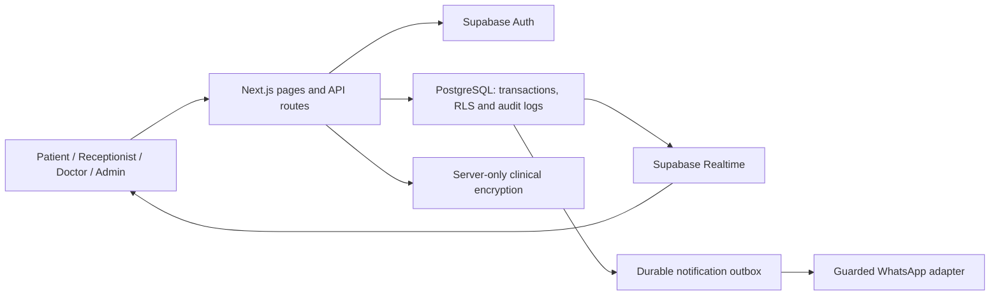

# Clinic Queue & Operations Platform

A full-stack healthcare operations prototype for a Singapore family-clinic use case, built with Next.js, TypeScript and Supabase.

**Independent portfolio prototype developed to explore digital queue, appointment and clinic-workflow software for a Singapore family-clinic use case. It is not an official system of, endorsed by, or deployed for Jo-Lin Family Clinic & Surgery. All demonstration patients and clinical records are synthetic.** Clinic branding and public business contact details retained in the prototype do not establish affiliation. No PDPA certification, medical regulatory approval or production security certification is claimed.

## Overview

- Patient: remote queue joining, live queue tracking, wait estimates, appointments, visit history and printable prescriptions.
- Receptionist: walk-in registration, call-next, recall, skip, emergency priority and queue pause/resume.
- Doctor: patient context, consultation workflow, protected clinical notes, prescriptions and visit completion.
- Admin: operational analytics, staff invitations, clinic settings and audit history.

## Architecture

Next.js 15 App Router provides pages and server-side API routes. Supabase supplies PostgreSQL, Auth and Realtime; database row-level security (RLS) and server authorization enforce patient ownership and clinic/role boundaries. Tailwind CSS, shadcn components and Recharts support the interface and analytics.

Protected clinical fields use server-only AES-256-GCM application-layer encryption. This covers consultation notes/diagnosis, allergies/emergency contact, encrypted medical-record content and notification destinations/parameters; it is **not whole-database encryption**. Demographics, appointment reasons and prescription directions remain relational plaintext fields.



See the [architecture](docs/architecture.md) and [implementation status](docs/implementation-status.md) for security boundaries, algorithms and feature limitations.

## Engineering Highlights

- Transactional daily queue numbering and deterministic ordering; real-database tests exercise 16 concurrent joins and 12 simultaneous call-next requests.
- Concurrent call-next protection, admission replay protection and emergency priority that preserves ticket numbering.
- PostgreSQL exclusion constraints prevent overlapping appointments, including simultaneous booking attempts.
- Actual database RLS/SQL/API tests cover role permissions, patient ownership, cross-clinic denials and protected writes.
- Historical wait estimates account for active consultation time, emergency ordering and unavailable/paused queues.
- Authenticated clinical encryption, fail-closed missing-key behavior and server-secret client-bundle checks.
- Durable notification outbox with deduplication, bounded retries and containment of uncertain provider delivery; local tests mock provider transport.
- Role-based workflows and audit logging for operational and clinical actions.
- Local backup/restore rehearsal checks restored relationships and clinical decryption in a separate database.
- Private Storage reservation with local upload/access-denial tests. Application document management is not implemented.

## Verification

Latest local acceptance evidence: **4 October 2026**.

| Check | Result |
| --- | --- |
| Unit tests | 49 passing in the release rerun; earlier acceptance reported 46 |
| Local integration tests | Earlier acceptance: 25 passing against real local Auth/PostgreSQL/RLS/Realtime and the optimized application. Release rerun: 12 pass / 13 fail because the preserved owner-demo fixtures trigger the cleanup guard; full rerun requires fresh local test fixtures |
| TypeScript typecheck | Passing |
| ESLint | Passing |
| Optimized production build | Passing locally; no cloud deployment |
| `npm audit --omit=dev` | Zero production dependency findings |
| Responsive browser checks | Completed at 390, 768 and 1440px using synthetic data |
| Local restore/decryption rehearsal | Passing; not a hosted recovery certification |

**Eight high-severity development-tool findings remain** through the unpatched `braces` advisory and its glob/tooling consumers. They are documented in the [development dependency security review](docs/development-security-review.md); no advisory suppression or forced dependency downgrade was applied. Zero production audit findings do not constitute a security certification.

`npm test` deliberately skips environment-dependent integration/staging cases when their required environments are absent. Those skips are not passes; run the separate local integration command below.

The release integration attempt stopped at `Refusing to clear nonfixture data`: owner-demo patients use the `DEMO —` prefix, while integration cleanup accepts only `LOCAL TEST` patients. The dependent audit assertion also failed because guarded workflow tests had not executed. The guard was retained and the demo database was not reset. The documented 25-test pass is earlier acceptance evidence, not a passing release rerun.

## Screenshots

Local synthetic-data browser evidence was reviewed at the widths above. Raw screenshots, authentication state, identity manifests and verification artifacts remain private and are excluded from this repository.

## Local Setup

Requirements: Node.js 24 (locally checked with 24.15.0), npm and Docker Desktop. Supabase CLI commands run through `npx`. Use only a disposable local database and synthetic records.

```powershell
npm ci
npx supabase start
npx supabase db reset
npm run bootstrap:local
npm run dev:local-test
```

`db reset` clears the local database. Bootstrap creates synthetic patient, second-patient, receptionist, doctor and admin Auth identities and application mappings. It generates local passwords, an encryption key and a worker secret into ignored `.local-verification/identities.json` and `.env.test.local`. Inspect these files privately for local sign-in; never publish their contents. Rerun bootstrap after a reset.

The local launcher binds to `127.0.0.1:3100`, rejects remote Supabase URLs and blanks WhatsApp credentials. Local patient demonstrations use the existing email/password login tab with synthetic identities; they do not prove phone OTP or SMS delivery. `.env.example` contains empty credential placeholders only.

Run checks in a second terminal while the local application is available:

```powershell
npm test
npm run typecheck
npm run lint
npm audit --omit=dev
npm run test:integration
```

For optimized-build acceptance, load the ignored local configuration without printing its values:

```powershell
node --env-file=.env.test.local -e "require('node:child_process').execSync('npm run build', { stdio: 'inherit' })"
# Stop the dev server before starting the optimized app on the same port.
npm run start:local-test
# Second terminal:
npm run test:integration
node --env-file=.env.test.local scripts/verify-missing-key.mjs
node --env-file=.env.test.local scripts/verify-client-bundle.mjs
```

The integration suite operates on disposable synthetic fixtures. Do not point it at a hosted project. The missing-key check requires the optimized build, a free loopback port 3101 and the fixture ticket left by integration acceptance.

## Status

**Completed and locally verified portfolio prototype. Not cleared for real patient use.**

Cloud-provider staging, hosted role/Realtime/browser acceptance, real SMS/WhatsApp delivery and hosted recovery remain unverified because credentials are unavailable. Appointment cancellation/rescheduling/check-in, application document management and some operational controls remain outside the implemented scope. Production use would require independent security and clinical review, legal/privacy decisions and operational acceptance; none is claimed here.

The [roadmap](docs/roadmap.md), [cloud staging runbook](docs/cloud-staging-runbook.md) and [synthetic local demonstration script](docs/owner-demo-script.md) describe these boundaries. Public GitHub publication does not deploy the application or authorize production infrastructure changes.
